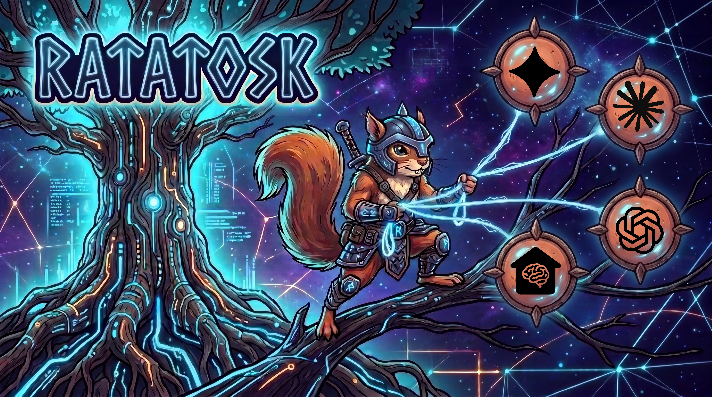
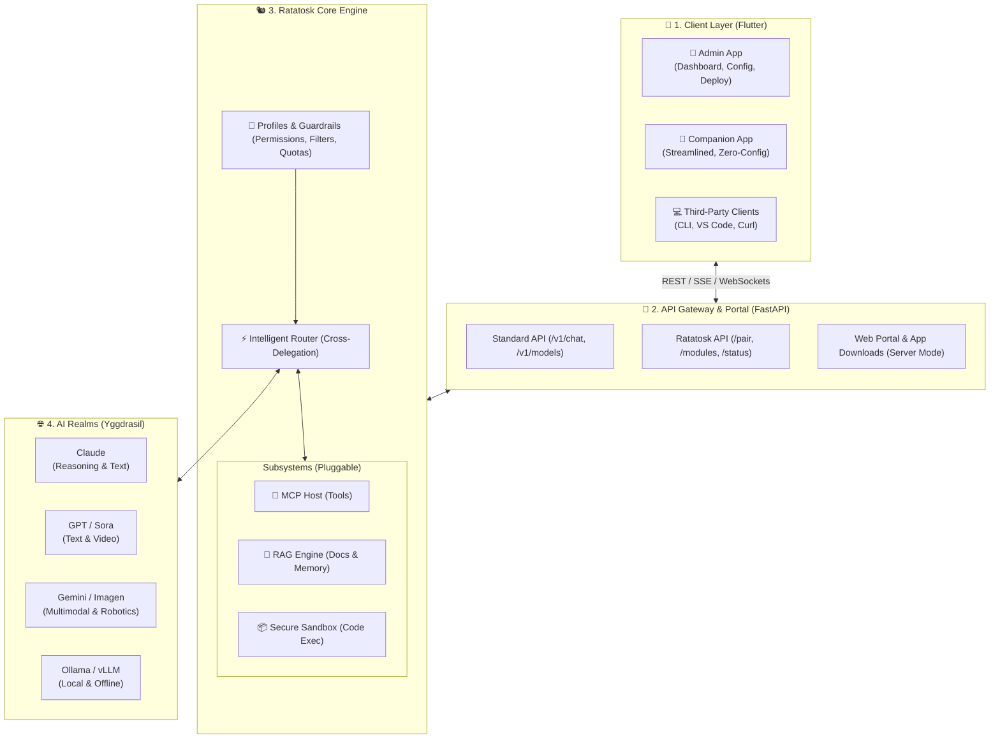
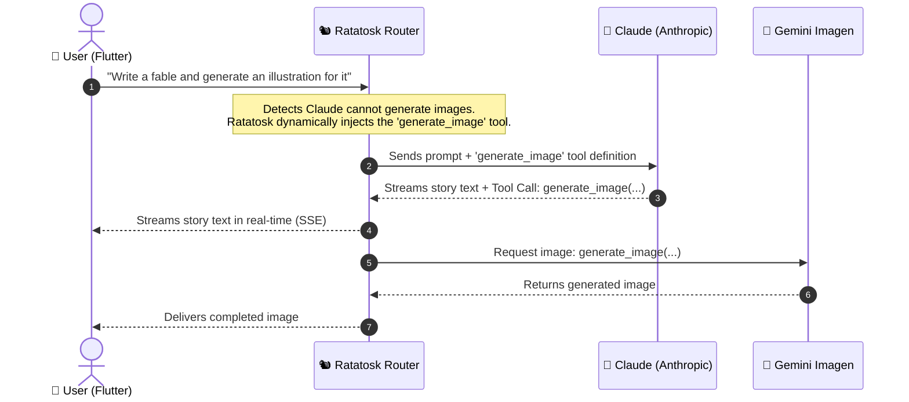
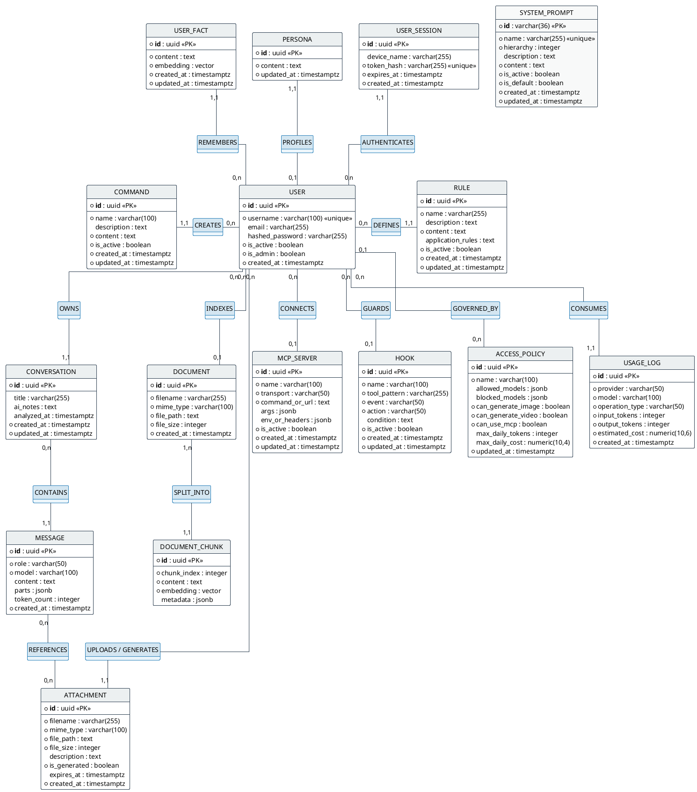

# 

  <strong>The universal and highly customizable orchestrator that unifies all AI models and combines their skills.</strong>

  
  
  
  

---

## Why Ratatosk 🐿️

In Norse mythology, **Ratatosk** is the squirrel that runs along the world tree, Yggdrasil, carrying messages between all the realms.

Today, every AI has its own strengths and limitations:
- **Using Claude and need an image?** 👉 Anthropic does not provide a native image generation model, so Ratatosk delegates the request to Gemini or Flux in the background.
- **Want a video from a local server?** 👉 Ratatosk orchestrates the call to OpenAI Sora or Runway.
- **Need specialized models?** 👉 Integrate Gemini's computer vision and robotics, or run private local models via Ollama without modifying your client code.
 
---

## Built for Everyone 🎯

Ratatosk is designed for everyone—from everyday users with zero technical background to families, teams, and experienced developers:

* **Family** : Simple and secure, with safety guardrails for children and code execution disabled.
* **Teams & Companies** : Shared knowledge bases (RAG), cost control, usage monitoring, and private models.
* **Power Users & Developers** : MCP tools, execution sandboxes, and unrestricted local models.
 

---

## Two Ways to Run 🚀

| 🖥️ Local Mode | 🌐 Server Mode |
|:---|:---|
| **Runs locally on your computer** | **Deployed on a remote server or VPS** |
| **Best for:** Developers, creators, and individuals working on their own machine. | **Best for:** Families, teams, communities, and businesses. |
| The API runs on `localhost`. Instant setup, ultra-low latency, and zero network exposure. | Distributes a secure, simplified companion app to members via a built-in download portal with QR-code pairing. |
 

---

## System Architecture 🏗️

### Cross-Delegation in Action ⚡

How Ratatosk bridges capabilities between models behind the scenes:

---

## Database Architecture (MCD) 🗄️

Ratatosk centralizes its state, relational history, and attachments in a unified database (SQLite locally, PostgreSQL + pgvector on servers):

### Key Design Principles:
1. **User Ownership (`USER`)**: Unifies local single-user mode (auto-seeded admin) and multi-user remote server deployments without schema alterations.
2. **Turn-by-Turn Model Selection & Working Memory (`MESSAGE.model` & `CONVERSATION.ai_notes`)**: The AI model is attached to the *message*, not the *conversation*, enabling seamless switching between models within the same thread, while `ai_notes` gives the AI a persistent per-conversation scratchpad to track context, decisions, or rolling summaries across models and turns.
3. **Deployment-Level Modular Prompting (`SYSTEM_PROMPT`)**: Independent configuration modules managed at the instance level. All active modules are compiled globally for the deployment, applying the unified system persona consistently across all users and conversations.
4. **User-Level Custom Instructions & Commands (`RULE` & `COMMAND`)**:
   - `RULE`: Personal guidelines and behaviors owned by each user, injected automatically or conditionally via `application_rules` (e.g., when analyzing images or writing code).
   - `COMMAND`: Explicit user-triggered action templates (e.g., `/summarize`, `/review`) injected on demand to enforce a specific task workflow.
5. **Hybrid Background User Profiling (`PERSONA` & `USER_FACT`)**: Built asynchronously when the server is idle by analyzing conversations (`CONVERSATION.analyzed_at`):
   - `PERSONA`: Compact core identity sheet (name, age, general profile) always injected in context for tone and safety.
   - `USER_FACT`: Atomic user facts stored with vector embeddings (`embedding`) and retrieved selectively via semantic search (RAG) only when relevant to the current prompt.
6. **Unified Attachments & Purge Policy (`ATTACHMENT`)**: Handles chat attachments and AI-generated media (images, videos, audio) with an optional `description` (for lightweight context in subsequent turns) and an `expires_at` retention policy for automated background cleanup.
7. **Shared & Private Knowledge Base (`DOCUMENT` & `DOCUMENT_CHUNK`)**: A single `DOCUMENT` entity linked to `USER` via a `0,n` — `0,1` relation: `0` user means a global deployment document shared with everyone, while `1` user means a private user document. Each document is split into vectorized `DOCUMENT_CHUNK`s for semantic retrieval.
8. **Decoupled MCP Servers & Tool Guardrails (`MCP_SERVER` & `HOOK`)**:
   - `MCP_SERVER`: Dynamic MCP server configurations (`stdio`, `sse`, `http`), linked in `0,1` to `USER` (supporting both instance-wide servers and personal user integrations).
   - `HOOK`: Intentionally decoupled from `MCP_SERVER` so manual guardrails (`tool_pattern`, `event`, `action` such as confirmation prompts or blocks, and `condition`) apply uniformly to both MCP tools and native built-in tools.
9. **Admin Access Control & Quotas (`ACCESS_POLICY`)**: Allows the administrator (e.g., family server host or team admin) to restrict specific users or groups (`0,1` — `0,n`) by whitelisting/blacklisting models (`allowed_models`, `blocked_models`), toggling capabilities (`can_generate_image`, `can_generate_video`, `can_use_mcp`), and enforcing daily token or cost ceilings.
10. **Persistent Telemetry & Cost Tracking (`USAGE_LOG`)**: Tracks every model invocation (`chat`, `image_gen`, `embedding`, `persona_worker`) with `input_tokens`, `output_tokens`, and `estimated_cost`. Linked directly to `USER` rather than `MESSAGE` so usage history and budget enforcement remain intact even when a user deletes their conversations.

